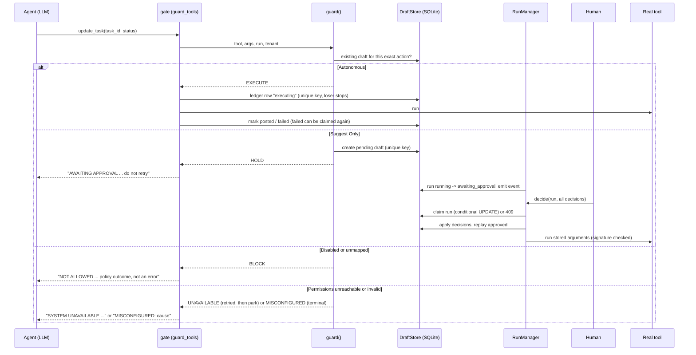

# agent-guardrails

Deterministic permissions and human-in-the-loop approval for LLM agents: the model proposes, code decides.

> An open-source reference implementation of deterministic permissions and human approval for LLM agents. All names and data are fictional.

[](https://github.com/Tayyab-Bilal/agent-guardrails/actions/workflows/ci.yml)

## At a glance

**What it is.** A small Python library that sits between an LLM agent and its write tools. Code, not the model, decides if each write runs now, waits for a human, or is refused.

**What is built** (in this repo, working and tested):

- Wrap write tools so every call is checked first: `src/agent_guardrails/gate.py: guard_tools()`
- Decide run / hold / block for one call, and an existing human answer wins: `src/agent_guardrails/gatekeeper.py: guard()`
- Map each tool to a permission action, deny anything unmapped: `src/agent_guardrails/resolver.py: mode_for()`
- Read the three modes (Autonomous, Suggest Only, Disabled) fresh on every call: `src/agent_guardrails/permissions.py: load_permissions()`
- Tell "service down" and "bad config" apart from "disabled": `src/agent_guardrails/gatekeeper.py: _load()`
- Store drafts, one per exact action, with a signature over the arguments: `src/agent_guardrails/drafts.py: DraftStore`
- Write the approval sentence with names instead of ids, with capped lookups: `src/agent_guardrails/describe.py: DeterministicDescriber`, `src/agent_guardrails/resolve.py: resolve_names()`
- Park the run, emit an event, settle all drafts in one call (a second call gets 409): `src/agent_guardrails/runs.py: RunManager.finish()`, `RunManager.decide()`
- Run approved drafts from the stored arguments, exactly once: `src/agent_guardrails/replay.py: execute_draft()`
- Run autonomous writes exactly once with a ledger row claimed first: `src/agent_guardrails/drafts.py: begin_autonomous()`
- Record blocked, held and executed steps in code, not by the model: `src/agent_guardrails/outcome.py: RunOutcome`

**What is not built / simplified here:**

- The permissions service is simulated. There is a static source, a file source, and an HTTP source that takes an injected `get_json`. No real service is called.
- Storage is one SQLite connection behind a lock. Many workers would need Postgres.
- The tools and backend are a fictional in-memory app (`acme_tools.py`).
- The event sink is an in-memory list. Nothing posts a webhook and there is no approval UI.
- It is not a sandbox. Only the tool copies from `guard_tools` are gated.
- A crashed `executing` row needs a human to look at it. A parked run has no built-in resume trigger.
- The mutation budget (default 150) is in memory and per `guard_tools` call.
- Tests use fake LLMs. No network, no API keys.

**How a write flows:**

1. The agent calls a guarded tool. The wrapper in `gate.py: guard_tools()` calls `gatekeeper.py: guard()` before anything runs.
2. `guard()` looks for a draft for this exact action (`idempotency.py: idempotency_key()`). If a human already answered, that answer wins.
3. With no draft, `resolver.py: TOOL_ACTIONS` blocks unmapped tools. Otherwise `permissions.py: load_permissions()` fetches the mode and `resolver.py: mode_for()` reads it.
4. Autonomous: `drafts.py: begin_autonomous()` claims a ledger row, then the real tool runs. Suggest Only: `drafts.py: create_pending()` stores a draft, with a sentence from `describe.py: DeterministicDescriber.describe()`. Disabled: the call is refused.
5. When the agent stops, `runs.py: RunManager.finish()` parks the run as `awaiting_approval` and emits one event.
6. A human answers with one `runs.py: RunManager.decide()` call. It claims the run with a conditional UPDATE, so a second call gets 409.
7. `replay.py: replay_approved()` runs each approved draft from its stored arguments, after `execute_draft()` claims it and checks the signature.

**Run it:**

```bash
uv venv .venv && uv pip install -e ".[dev]"
.venv/bin/pytest -q
```

Current result: 95 passed in about 2 seconds. For the story end to end: `.venv/bin/python examples/demo.py`.

## How each part works, one by one

### 1. The tool-to-permission map, deny by default

- **Risk / problem:** The model can call a tool nobody planned for, or a destructive tool that sounds close to an allowed one. If the code guesses, a tenant who allowed edits ends up allowing deletes.
- **How it works:**
  - A fixed table ties each write tool to exactly one named permission action. The model cannot change this table, only code can.
  - Destructive tools such as deleting a project are listed on purpose as denied. They are never mapped to a "nearby" action, because allowing edits never meant allowing deletion (`resolver.py: TOOL_ACTIONS`, `resolver.py: ALLOWED_UNGATED`).
  - Anything not in the table is refused before any permission lookup is made. A missing action, an empty config or a mode name nobody recognises all read as Disabled (`resolver.py: mode_for()`, `resolver.py: canonical_permissions()`).
  - Read tools pass through because they sit on an explicit read list. Every tool must be in one of three lists, so a brand new tool cannot slip through unnoticed.
  - Wiring fails closed: if a tool is in none of the lists, setup raises an error instead of running it silently (`gate.py: guard_tools()`).
- **Tests that prove it:** `tests/test_resolver.py`: `test_unmapped_tool_is_denied`, `test_invented_tool_is_denied`, `test_empty_config_denies_everything`, and `test_unknown_mode_string_denies`, `test_new_unclassified_tool_is_caught_and_refused` as well. Also `tests/test_gatekeeper.py`: `test_attacker_text_in_args_cannot_raise_autonomy`.

### 2. Permission modes, read fresh every call

- **Risk / problem:** If permissions are cached, a tenant who switches an action to Disabled still sees it run. If the model could influence the mode, it could talk its way into more freedom.
- **How it works:**
  - Each action has one of three modes: Autonomous (run now), Suggest Only (hold for a human) or Disabled (refuse).
  - The mode is fetched again on every single gated call, so a settings change takes effect on the very next call (`permissions.py: load_permissions()`).
  - The decision is a plain lookup on the tool name and the tenant config. The arguments the model sends are never used to pick a mode, so text hidden in a field is just text (`gatekeeper.py: guard()`).
  - The source of permissions is swappable: a fixed dict, a file, or an HTTP call through an injected function. The real service is simulated here (`permissions.py: StaticPermissionSource`).
- **Tests that prove it:** `tests/test_gatekeeper.py`: `test_tool_arguments_cannot_change_the_gate`, `test_attacker_text_in_args_cannot_raise_autonomy`, `test_existing_draft_wins_over_mode_change`. `tests/test_permissions.py`: `test_file_source_reads_fresh_and_flags_bad_json`.

### 3. Idempotency key and drafts

- **Risk / problem:** The model retries, rephrases or repeats a call. Without a stable identity for "this exact action" you get duplicate approvals, or one approval reused on a different target.
- **How it works:**
  - Arguments are cleaned into one standard form first: empty values dropped, keys sorted, and a number written as text treated the same as the number. So harmless noise does not create a "new" action.
  - The key is a hash of the run, the tool and those cleaned arguments. Same action in the same run gives the same key, and a different target gives a different key, so approving one task never approves another (`idempotency.py: idempotency_key()`).
  - A draft is a stored row for one held action, unique on run plus key. Asking twice returns the same draft instead of making a second one (`drafts.py: DraftStore.create_pending()`).
  - The draft keeps the original arguments and a signature over them, made with a secret key. Any edit to the stored text breaks the signature (`drafts.py: DraftStore.verify()`).
  - Simplification: a zero-padded id like "007" is treated as 7, which is noted as a known trade-off.
- **Tests that prove it:** `tests/test_idempotency.py`: `test_arg_noise_maps_to_same_key`, `test_real_differences_change_the_key`. `tests/test_gatekeeper.py`: `test_same_call_twice_does_not_duplicate_draft`, `test_different_target_needs_new_approval`.

### 4. Exactly-once ledger and claim

- **Risk / problem:** Two workers, a retry or a restart can run the same write twice. Charging twice or emailing twice is worse than doing nothing.
- **How it works:**
  - Before an autonomous write runs, the code first inserts a ledger row marked "executing". The database allows only one row per action, so only one caller wins and the loser does nothing (`drafts.py: DraftStore.begin_autonomous()`).
  - Approved drafts work the same way: the move from approved to executing is one conditional update, and only the caller that changed the row may run the tool (`drafts.py: DraftStore.claim()`).
  - If the process crashes mid-write, the row stays "executing" and is never re-run, because the effect may already have happened. A human has to check it. Simplification: there is no automatic repair, only a list of stuck rows (`drafts.py: DraftStore.list_stuck()`).
  - If a write fails cleanly, it is marked failed and may be claimed again, but only if the policy still says Autonomous.
  - There is also a cap on writes per run, 150 by default. Calls that lose a race or are blocked do not count (`gate.py: guard_tools()`).
- **Tests that prove it:** `tests/test_gatekeeper.py`: `test_concurrent_identical_autonomous_calls_run_once`, `test_crash_mid_autonomous_write_is_not_rerun_on_resume`, `test_failed_reclaim_is_atomic_only_one_retry_wins`, and others on retries and the budget. `tests/test_replay.py`: `test_concurrent_replays_execute_exactly_once`, `test_claim_is_atomic_across_threads`, `test_crash_mid_execution_is_not_rerun`.

### 5. Park the run, one decision, replay

- **Risk / problem:** A human answers hours later, maybe from another process, with many drafts waiting. Per-draft answers can leave a run half done, and two reviewers can race.
- **How it works:**
  - When the agent stops with drafts still pending, the run is parked as "awaiting approval" and one event listing every draft is emitted. The event goes to an in-memory list here, not a real webhook (`runs.py: RunManager.finish()`).
  - One decide call must answer exactly the pending drafts, no more and no fewer. A mismatch is rejected and the run goes back to waiting (`runs.py: RunManager.decide()`).
  - The call first claims the run with one conditional update. A second or simultaneous call finds the run already claimed and gets a 409 conflict.
  - Approved drafts then run from the stored arguments, never from a fresh model answer, and the signature is checked first. The arguments are also validated against the tool's schema again. Rejected drafts never run (`replay.py: execute_draft()`).
- **Tests that prove it:** `tests/test_runs.py`: `test_second_decision_gets_conflict_409`, `test_concurrent_decisions_exactly_one_wins`, `test_decisions_must_cover_exactly_the_pending_drafts_and_release_the_claim`, and 6 more in that file. `tests/test_replay.py`: `test_replay_uses_stored_args_not_new_llm_args`, `test_edited_stored_args_without_key_refuses_to_run`, `test_stored_args_are_revalidated_against_tool_schema`, and 16 more in that file.

### 6. Unavailable versus misconfigured versus disabled

- **Risk / problem:** If a failed permissions lookup is reported as "disabled", users go and check settings that were fine. Worse, a broken lookup might be treated as "allowed".
- **How it works:**
  - Errors that look temporary, such as a timeout, are retried twice with growing pauses. If they keep failing the answer is "unavailable": nothing runs, and the run is parked so it can resume later (`failure.py: run_with_retry()`).
  - Errors that will not fix themselves, such as a bad payload or an unreadable file, are "misconfigured". These are not retried and the real cause is shown.
  - The payload shape is checked before it is trusted. Anything off is misconfigured, never quietly treated as a mode (`permissions.py: _validate()`).
  - Neither case is ever worded as "disabled", and neither runs the write. Only a real Disabled mode says the organisation turned it off (`gatekeeper.py: _load()`).
- **Tests that prove it:** `tests/test_permissions.py`: `test_unavailable_is_retried_then_parked_never_reported_as_disabled`, `test_misconfigured_is_terminal_with_the_real_cause_and_not_retried`, `test_transient_error_that_recovers_runs_the_write`, and 7 more in that file. `tests/test_runs.py`: `test_all_blocked_run_finishes_failed_and_outage_finishes_parked`.

### 7. The coverage test for unmapped write tools

- **Risk / problem:** Someone adds a new write tool next month and forgets to classify it. It would then run with no policy, and nobody notices.
- **How it works:**
  - There are three lists: mapped write tools, deliberately denied write tools, and read tools. A tool must be in exactly one of them.
  - A test builds the real tool set and fails in CI if any tool is in none of the lists, or in two of them. A new tool cannot be merged until someone decides what it is (`gate.py: unclassified_tools()`).
  - The same check runs at wiring time, so a missing tool fails at startup instead of at the first call (`gate.py: guard_tools()`).
  - Even if it somehow got past both, an unknown tool name is refused at call time.
- **Tests that prove it:** `tests/test_resolver.py`: `test_every_mutating_tool_is_mapped_or_explicitly_denied`, `test_new_unclassified_tool_is_caught_and_refused`, `test_unmapped_tool_is_denied`.

See also the older [What it does](#what-it-does) and [Design decisions](#design-decisions) sections, which are the short versions of this.

## The problem

An autonomous agent runs at 3 a.m. with nobody watching. If the model calls `delete_project`,
it happens on real data. Organisations need a per-action choice, **do it / ask me first /
never**, that holds even when the model misbehaves: prompt injection, invented tools, retried
runs.

Approvals are asynchronous. A human answers hours later, possibly in another process, with many
drafts outstanding, and exactly the approved action must then run **exactly once**. The setting
here is a fictional "Acme Workspace" app (tasks, projects, meetings).

## What it does

- **Three modes per action** (Autonomous, Suggest Only, Disabled) read fresh from tenant config on
  every gated call. `resolver.py`, `permissions.py`
- **Pure, deny-by-default resolver.** A static map ties each write tool to one action; tools
  denied on purpose are listed; anything else is refused. A test and a wiring check fail on a new
  unclassified tool. `resolver.py`, `gate.py`
- **One choke point.** `guard_tools` returns gated copies of the tools, keeping name and schema.
  `gate.py`
- **A decision engine** where an existing draft for the exact action wins over today's mode.
  `gatekeeper.py`
- **Per-action drafts** unique on (run, idempotency key), with argument normalisation and an
  HMAC over the stored arguments. `drafts.py`, `idempotency.py`
- **Failure verdicts.** A permissions outage is retried and then parked as resumable; a bad
  config is terminal with its real cause. Neither is ever reported as "disabled".
  `failure.py`, `gatekeeper.py`
- **Run outcomes.** Blocked and rejected calls are recorded as skipped steps, and a run where
  every write was blocked ends `failed`. `outcome.py`
- **Approve and resume.** A run with drafts parks as `awaiting_approval`, emits a
  CloudEvents-shaped event, and one `decide` call settles every draft behind an atomic
  single-flight claim (a second call gets 409). `runs.py`
- **Human-readable approvals.** Bounded id-to-name lookups (12 at most, 6 s total, including
  nested bulk arguments), then a sentence from a deterministic or LLM describer, with ids stripped
  recursively. `resolve.py`, `describe.py`
- **Deterministic replay** of approved drafts from stored arguments, exactly once. `replay.py`
- **Exactly-once autonomous writes** through a ledger row claimed before the call; a failed write
  stays retryable, a crashed one is never re-run. `drafts.py`, `gate.py`
- **A swappable permission backend**: static, file, or HTTP through an injected `get_json`.
  `permissions.py`

## Quickstart

```bash
uv venv .venv && uv pip install -e ".[dev]"
.venv/bin/pytest -q
.venv/bin/python examples/demo.py
```

Excerpt of the demo output (an agent runs unattended, then a human answers):

```text
--- the agent runs unattended ---
1. create_task (Autonomous)        {'task_id': 't6'}
2. update_task (Suggest)           AWAITING APPROVAL: "Update Task for 'Draft spec': status='done'" was sent to ...
3. bulk update, 4 tasks (Suggest)  AWAITING APPROVAL: "Update Task for 'Review budget', 'Book venue', 'Send invites' and 1 more: updates=<4 items>" ...
4. delete_project                  NOT ALLOWED: 'delete_project' has no permission mapping. This is a policy outcome, ...
6. run finished as                 awaiting_approval

--- hours later, a human answers with ONE call ---
7. decide (reject / approve)       {'state': 'running', 'approved': 1, 'rejected': 1, 'posted': 1, 'failed': 0}
8. a second decision               409 Conflict

--- the permissions service goes down ---
10. create_task                    SYSTEM UNAVAILABLE: the permissions service could not be reached (...). Nothing was done. ...
```

## Usage guide

A complete, runnable run (this block is executed by the test suite). More in
[docs/usage.md](docs/usage.md); the signatures are in [docs/api.md](docs/api.md).

```python
import asyncio

from agent_guardrails import (
    DeterministicDescriber, DraftStore, ListSink, RunManager, RunOutcome,
    StaticPermissionSource, guard_tools,
)
from agent_guardrails.acme_tools import AcmeBackend, build_tools

CONFIG = {"categories": [
    {"name": "Tasks", "actions": [{"name": "Create Task", "mode": "Autonomous"},
                                  {"name": "Update Task", "mode": "Suggest Only"}]},
]}


async def main() -> None:
    backend = AcmeBackend()
    backend.tasks = {"t1": {"title": "Draft spec", "status": "open"}}

    async def lookup(kind, id_):  # id -> name, so the approver never sees an id
        return backend.tasks.get(id_, {}).get("title")

    store, sink, outcome = DraftStore(hmac_key=b"a-real-secret"), ListSink(), RunOutcome()
    runs = RunManager(store, sink)
    tools = {t.name: t for t in guard_tools(
        build_tools(backend), run_id="run-1", tenant_id="acme", user_id="sam",
        permissions=StaticPermissionSource(CONFIG), store=store,
        describer=DeterministicDescriber(lookup), outcome=outcome)}
    runs.start("run-1")

    await tools["create_task"].ainvoke({"title": "Q4 review"})                  # runs
    held = await tools["update_task"].ainvoke({"task_id": "t1", "status": "done"})  # drafted
    denied = await tools["delete_task"].ainvoke({"task_id": "t1"})              # refused
    assert held.startswith("AWAITING APPROVAL") and denied.startswith("NOT ALLOWED")

    assert runs.finish("run-1", outcome) == "awaiting_approval"
    (draft,) = sink.events[0]["data"]["drafts"]
    assert draft["description"] == "Update Task for 'Draft spec': status='done'"

    # Later, possibly in another process: one call settles every draft, then replays.
    result = await runs.decide("run-1", {draft["draft_id"]: "approved"}, tools)
    assert len(result["posted"]) == 1 and backend.tasks["t1"]["status"] == "done"


asyncio.run(main())
```

All LLMs sit behind a tiny `TextLLM` protocol, and the tests use fakes. No network, no API keys.

## How it works



The flow for one gated call:

1. The agent calls a guarded tool. The gate runs `guard()` before any side effect.
2. `guard()` looks for a draft for this exact action (run + tool + canonical arguments). If one
   exists it wins: approved executes, rejected or posted is skipped, pending holds.
3. With no draft, policy decides. Unmapped tools are blocked before any network call. Otherwise
   permissions are fetched fresh. A transient failure is retried twice, then reported as
   `SYSTEM UNAVAILABLE`. A bad payload is `MISCONFIGURED`.
4. Autonomous calls claim a ledger row and then run. Suggest Only calls create a draft, with a
   sentence written from resolved names. Disabled calls are refused.
5. Every outcome is recorded on the `RunOutcome`. When the agent stops, `RunManager.finish`
   sets the run state. Pending drafts park the run and emit the event.
6. `decide` claims the run, settles all drafts, and replays the approved ones from their stored
   arguments. Each draft is itself claimed with a conditional `UPDATE`.

## Design decisions

1. **Model proposes, code decides.** Allow or deny is a pure function of a static map and tenant
   config. The LLM only proposes calls and may write a sentence. *Rejected:* asking the model to
   judge its own call, which prompt injection can talk around.
2. **Deny by default.** Unknown, unmapped or malformed means `DISABLED`. *Rejected:* mapping
   `delete_task` to the nearest allowed action ("Update Task"), because a tenant who allowed edits
   never agreed to deletion.
3. **Gate before side effects, at one choke point.** Every write tool is wrapped at one
   registration site. Here the wrapper returns copies, so only code holding the guarded list is
   gated; the originals are not. *Rejected:* checking inside each tool, which one new tool forgets.
4. **Policy on the action type, approval on the concrete instance.** The key hashes run, tool and
   canonical arguments, so one approval cannot be replayed against a different target.
   *Rejected:* approving "update_task" in general.
5. **Approved means these exact arguments.** The stored call runs, never a fresh LLM
   regeneration, and an HMAC over the stored text is verified first. *Rejected:* re-asking the
   model to redo the call after approval.
6. **Exactly once.** An idempotency key per action plus an atomic claim before every side effect.
   A crashed `executing` row is never re-run, since the effect may have happened; a cleanly
   `failed` autonomous row may be claimed again. *Rejected:* retrying anything not marked done.
7. **Fail closed, and never present an infrastructure failure as a policy decision.** An outage
   is `SYSTEM UNAVAILABLE` (park, resumable) and a bad config is `MISCONFIGURED: <cause>`.
   *Rejected:* treating a failed fetch as "Disabled", which sent users to check settings that
   were fine.
8. **Data is data.** Approval text has no raw ids and tool arguments cannot change the gate.
   Attacker-shaped text in a field is just text. *Rejected:* letting argument content select a mode.
9. **Policy outcomes are not failures, but all-blocked is.** Blocked and rejected steps are
   skipped steps. A run where every write was blocked finalises `failed` so it never reads as
   success. *Rejected:* relying on the model to report what was refused.
10. **One decision call, one atomic claim.** `decide` settles all drafts at once behind a
    conditional `UPDATE` on the run row; the loser gets 409. *Rejected:* per-draft decisions,
    which leave a run half-resumed and race when two reviewers click.
11. **Soft-yield instead of `interrupt()`.** Durable drafts are reconciled when the agent is
    re-invoked, because resume is driven from outside and fans out across many drafts. A later
    `interrupt()` spike confirmed it: nested agents without checkpointers never propagated the
    interrupt. *Rejected:* LangGraph `interrupt()`.

## Testing

```bash
.venv/bin/pytest -q
.venv/bin/ruff check .
```

No network and no LLM. The suite runs in a couple of seconds.

| Rule | Test file / examples |
|---|---|
| Unmapped, invented and unclassified tools are denied; coverage guardrail | `test_resolver.py` |
| Autonomous ledger: exactly once, resume is a no-op, crash never re-run | `test_gatekeeper.py` |
| Failed autonomous write is retryable, atomically, only if still Autonomous | `test_failed_autonomous_write_stays_retryable`, `test_failed_reclaim_is_atomic_only_one_retry_wins` |
| Existing draft beats a mode change; rejected never executes | `test_gatekeeper.py` |
| Attacker text in arguments cannot change the gate | `test_attacker_text_in_args_cannot_raise_autonomy` |
| Unavailable is retried then parked, misconfigured is terminal, neither says "disabled" | `test_permissions.py` |
| HTTP source classifies errors through `classify` | `test_http_source_classifies_errors_through_the_classifier` |
| Blocked/rejected are skipped; all-blocked run fails | `test_outcome.py` |
| Run parks with one event; one decision settles all; concurrent decide gives one winner and 409s | `test_runs.py` |
| Bounded lookups: 12 max, timeout, nested bulk args, 13 targets read as one named approval | `test_describe.py` |
| Replay uses stored arguments, signature checked, concurrent replays run once | `test_replay.py` |
| Gate keeps schema, never mutates input, sync path cannot bypass | `test_gate.py` |
| Every README and docs example runs | `test_docs.py` |

## Limits & known trade-offs

- **Same-name targets are not handled.** A write to one of several same-named
  items is not refused unless the plan names the id; this repo does not add that check.
- **Not a sandbox.** Only the copies `guard_tools` returns are gated. A caller holding the
  original tool list can bypass it.
- **No state-injection test.** This repo keeps tool schemas intact but has no LangGraph
  `ToolNode` state-injection test.
- **A crashed `executing` row needs a human.** `store.list_stuck()` lists them. A parked
  (`parked`) run has no built-in resume trigger.
- **Identical calls are deduplicated by design.** The same tool with the same normalised
  arguments in one run is one action. Zero-padded numeric strings normalise to ints.
- **Mutation budget** (default 150) is per `guard_tools` call and in memory. Only calls that
  actually run consume it.
- **The HMAC key** must be rotated only when no approved drafts are outstanding. It does not
  protect against someone who holds the key.
- **Single process locking.** One SQLite connection behind a lock; use Postgres for many workers.
- **Approval text** for bulk calls shows names and a count, not every item.

## Project layout

```text
src/agent_guardrails/
  modes.py        the three modes
  resolver.py     tool -> action map, ALLOWED_UNGATED, READ_TOOLS, config -> Mode
  permissions.py  sources (static, file, HTTP), Unavailable vs Misconfigured, load_permissions
  failure.py      transient vs terminal classification, run_with_retry
  idempotency.py  argument normalisation, args hash, idempotency key
  drafts.py       SQLite drafts + ledger + run state, conditional-UPDATE state machine
  resolve.py      bounded async id -> name lookups
  describe.py     id-free approval sentences (deterministic or LLM)
  gatekeeper.py   guard(): existing draft wins, then policy and failure verdicts
  gate.py         guard_tools(): the choke point, mutation budget, outcome recording
  outcome.py      RunOutcome: steps recorded by code, run status
  runs.py         RunManager, awaiting_approval event, decide() with single-flight claim
  replay.py       run approved drafts from stored arguments, exactly once
  acme_tools.py   fictional backend and tools for tests and the demo
examples/demo.py  end-to-end story with fakes
docs/             usage.md, api.md
tests/            one file per area, plus test_docs.py
```

MIT licensed.
